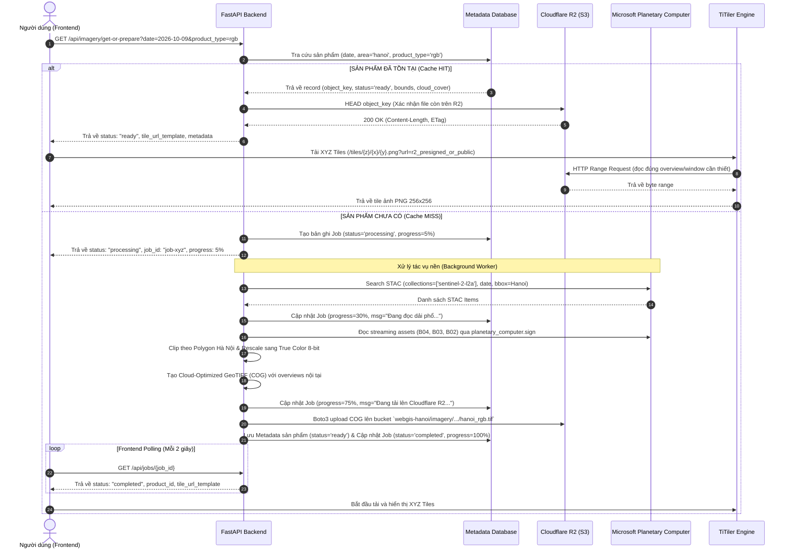

# KIẾN TRÚC HỆ THỐNG WEBGIS ẢNH VỆ TINH HÀ NỘI
*(Microsoft Planetary Computer + Cloudflare R2 + TiTiler + FastAPI + OpenLayers)*

---

## 1. TỔNG QUAN HỆ THỐNG

Hệ thống **Hanoi Satellite WebGIS** được thiết kế theo mô hình **On-Demand Processing & Intelligent Tiered Cache** (Xử lý theo nhu cầu và Bộ nhớ đệm phân tầng).
- **Mục tiêu cốt lõi**: Không tải hàng loạt terabyte dữ liệu Sentinel-2 về lưu trữ trước. Thay vào đó:
  1. Người dùng chọn ngày và tham số ảnh.
  2. Hệ thống kiểm tra cache trên **Cloudflare R2**.
  3. Nếu đã có (**Cache HIT**): Stream trực tiếp ảnh Cloud-Optimized GeoTIFF (COG) qua **TiTiler** đến giao diện **OpenLayers**.
  4. Nếu chưa có (**Cache MISS**): Kích hoạt tác vụ nền truy vấn **Microsoft Planetary Computer (MPC) STAC API**, tải và cắt theo ranh giới Hà Nội, tạo COG tối ưu overviews, tải lên Cloudflare R2, lưu metadata vào database, và trả kết quả hiển thị.

---

## 2. SƠ ĐỒ KIẾN TRÚC TỔNG THỂ (SYSTEM ARCHITECTURE)

```mermaid
flowchart TB
    subgraph CLIENT["Frontend - WebGIS Dashboard (OpenLayers + Modern UI)"]
        UI["Bản đồ vệ tinh Hà Nội<br/>(Zoom, Pan, Layer Control)"]
        DatePicker["Date Picker & Timeline<br/>(Lọc ngày có ảnh vệ tinh)"]
        CloudFilter["Cloud Cover Slider & Settings"]
        ProgressToast["Trạng thái xử lý thời gian thực<br/>(Polling / SSE Status)"]
    end

    subgraph BACKEND["Backend Core - FastAPI Modular Engine"]
        API["FastAPI REST Endpoints<br/>/api/imagery/* & /api/jobs/*"]
        CacheRouter{"Cache Router<br/>(Metadata DB + R2 check)"}
        Worker["Background Task Queue<br/>(Async Processing Pipeline)"]
        TiTilerSubApp["TiTiler COG Engine<br/>(XYZ Dynamic Tile Server)"]
        DB[(Metadata & Job Store<br/>SQLite / PostgreSQL)]
    end

    subgraph EXT_SERVICES["Hạ tầng & Nguồn dữ liệu đám mây"]
        MPC["Microsoft Planetary Computer<br/>(STAC Catalog + Sentinel-2 L2A Assets)"]
        R2["Cloudflare R2 Object Storage<br/>(S3-Compatible COG Data Lake)"]
        Boundaries["Hanoi GeoJSON Boundary<br/>(Polygon Ranh giới hành chính)"]
    end

    %% Luồng tương tác
    UI <-->|HTTP REST / JSON| API
    UI <-->|XYZ Raster Tiles /tiles/{z}/{x}/{y}.png| TiTilerSubApp
    DatePicker --> API
    CloudFilter --> API
    ProgressToast <-->|Job Status Check| API

    API --> CacheRouter
    CacheRouter -->|1. Tra cứu sản phẩm| DB
    CacheRouter -->|2. Kiểm tra tồn tại| R2

    CacheRouter -->|Cache HIT| TiTilerSubApp
    CacheRouter -->|Cache MISS| Worker

    Worker -->|1. Query STAC items| MPC
    Worker -->|2. Stream windowed bands & Clip| Boundaries
    Worker -->|3. Build COG & Upload| R2
    Worker -->|4. Lưu thông tin sản phẩm| DB

    TiTilerSubApp -->|HTTP Range Requests| R2
```

---

## 3. LUỒNG DỮ LIỆU & TRẠNG THÁI CACHE (DATA FLOW & STATE MACHINE)

### 3.1. Sơ đồ trạng thái Cache HIT / MISS



---

## 4. CHI TIẾT CÁC THÀNH PHẦN HỆ THỐNG

### 4.1. Frontend: WebGIS Dashboard (OpenLayers)
- **Mã nguồn**: Vanilla Modern ES6+ JavaScript hoặc Vite.
- **Giao diện**:
  - Dark mode cao cấp, bố cục Full-screen GIS chuyên nghiệp.
  - Sidebar điều khiển mờ kính (Glassmorphism).
  - Time-slider và Lịch chọn ngày vệ tinh (đánh dấu ngày có ảnh chụp Sentinel-2).
  - Thanh trượt lọc tỷ lệ mây (Cloud Coverage Slider: 0% - 100%).
  - Lớp bản đồ nền linh hoạt: CartoDB Dark, Google Hybrid, OpenStreetMap.
  - Layer Control: Điều chỉnh Opacity ảnh vệ tinh, Bật/tắt ranh giới hành chính Hà Nội.
  - Bảng thông số viễn thám: Ngày thu nhận, Vệ tinh, Tỷ lệ mây, Nguồn cảm biến, Độ phân giải (10m), Trạng thái Cache HIT/MISS.
  - Tải xuống GeoTIFF: Cho phép người dùng tải file COG đã cắt về máy để mở trên QGIS/ArcGIS.

### 4.2. Backend: FastAPI Core Engine
Được tổ chức theo nguyên lý **Clean Architecture** & **Modular Design**:
- `app/api/`: Định nghĩa các Router endpoint độc lập.
- `app/services/stac_service.py`: Chuyên tương tác STAC API Microsoft Planetary Computer.
- `app/services/raster_service.py`: Chuyên xử lý ảnh (đọc asset từ xa bằng windowed read, mask theo polygon Hà Nội, tính toán RGB/NDVI, xuất COG).
- `app/services/storage_service.py`: Quản lý Cloudflare R2 (S3 API qua `boto3`), kiểm tra cache, presigned URL.
- `app/services/tiler_service.py`: Tích hợp TiTiler trực tiếp hoặc qua proxy endpoint chuẩn XYZ.
- `app/tasks/worker.py`: Bộ điều phối background jobs phi đồng bộ.
- `app/models/`: Định nghĩa lược đồ dữ liệu (Pydantic & SQLAlchemy).

### 4.3. TiTiler COG Serving Engine
- Thay vì cài đặt một container TiTiler riêng biệt gây phức tạp khi chạy cục bộ, ta sử dụng thư viện `titiler.core`:
  ```python
  from titiler.core.factory import TilerFactory
  from fastapi import FastAPI

  cog = TilerFactory()
  app.include_router(cog.router, prefix="/titiler", tags=["TiTiler COG"])
  ```
- TiTiler đọc trực tiếp COG từ Cloudflare R2 thông qua đường dẫn S3 (`s3://webgis-hanoi/...`) với cấu hình GDAL ảo (`AWS_S3_ENDPOINT`, `AWS_ACCESS_KEY_ID`, `AWS_SECRET_ACCESS_KEY`) hoặc qua Presigned URL có chữ ký.
- Trình duyệt chỉ cần gọi: `/titiler/tiles/WebMercatorQuad/{z}/{x}/{y}.png?url=...` để nhận đúng lát cắt 256x256 pixel mà không bao giờ phải kéo cả file ảnh gigabyte về.

### 4.4. Cơ sở dữ liệu Metadata & Job Tracking
Sử dụng SQLite (giai đoạn đầu, không cần cài đặt thêm phần mềm) và sẵn sàng nâng cấp lên PostgreSQL/PostGIS thông qua SQLAlchemy.

**Bảng `imagery_products`**:
| Trường | Kiểu dữ liệu | Mô tả |
| :--- | :--- | :--- |
| `id` | String (UUID/Slug) | Khóa chính (ví dụ: `s2_20261009_hanoi_rgb`) |
| `acquisition_date` | Date | Ngày ảnh vệ tinh chụp |
| `collection` | String | Mặc định: `sentinel-2-l2a` |
| `product_type` | String | `rgb` (True Color), `ndvi`, `cir` (False Color) |
| `cloud_cover` | Float | Tỷ lệ mây của cảnh (0.0 - 100.0) |
| `source_scenes` | JSON | Danh sách các STAC Item ID gốc từ MPC |
| `r2_object_key` | String | Đường dẫn lưu trên R2 (VD: `imagery/sentinel-2-l2a/2026/10/09/hanoi_rgb.tif`) |
| `bounds` | JSON | Bounding box `[min_lon, min_lat, max_lon, max_lat]` |
| `file_size_bytes` | Integer | Dung lượng file COG (bytes) |
| `created_at` | DateTime | Thời gian tạo sản phẩm |

**Bảng `processing_jobs`**:
| Trường | Kiểu dữ liệu | Mô tả |
| :--- | :--- | :--- |
| `job_id` | String (UUID) | ID tác vụ |
| `product_id` | String | ID sản phẩm đang xử lý |
| `status` | String | `queued`, `processing`, `completed`, `failed` |
| `progress` | Integer | Phần trăm tiến độ (0 - 100) |
| `message` | String | Thông báo trạng thái (VD: "Đang cắt ranh giới...") |
| `error` | Text | Chi tiết lỗi nếu có |
| `created_at` | DateTime | Thời điểm bắt đầu |
| `updated_at` | DateTime | Thời điểm cập nhật cuối |

---

## 5. THIẾT KẾ BỘ NHỚ LƯU TRỮ TRÊN CLOUDFLARE R2

Cấu trúc Bucket `webgis-hanoi`:
```text
webgis-hanoi/
├── boundaries/
│   └── hanoi_boundary.geojson         # Ranh giới chính thức Hà Nội
├── imagery/
│   └── sentinel-2-l2a/
│       └── 2026/
│           └── 10/
│               └── 09/
│                   ├── hanoi_rgb.tif           # COG True Color (Red, Green, Blue)
│                   ├── hanoi_rgb.tif.aux.xml   # Metadata GDAL (tùy chọn)
│                   └── hanoi_ndvi.tif          # COG Chỉ số thực vật (phát triển mở rộng)
└── thumbnails/
    └── 2026-10-09-thumb.jpg           # Ảnh thu nhỏ cho danh sách ngày
```

---

## 6. BẢO MẬT VÀ PHÒNG CHỐNG LỖ HỔNG

1. **Chống SSRF (Server-Side Request Forgery)**:
   - TiTiler không được phép mở bất kỳ URL tùy ý từ bên ngoài.
   - Endpoint proxy hoặc factory chỉ chấp nhận đọc từ Bucket Cloudflare R2 được cấu hình sẵn trong biến môi trường hoặc từ domain Microsoft Planetary Computer đã được whitelist.
2. **Bảo vệ Secret Keys**:
   - `R2_ACCESS_KEY_ID` và `R2_SECRET_ACCESS_KEY` chỉ lưu ở file `.env` trên máy chủ Backend.
   - Không để lộ thông tin xác thực ra frontend. Tile URL trả về cho OpenLayers thông qua Proxy endpoint nội bộ hoặc Presigned URL ngắn hạn (expires in 3600s).
3. **Chống trùng lặp tác vụ (Duplicate Job Lock)**:
   - Sử dụng Mutex Lock trong bộ nhớ hoặc bảng Job trong database để đảm bảo khi 2 người dùng cùng lúc bấm chọn ngày 2026-10-09, hệ thống chỉ tạo duy nhất 1 background processing job.
