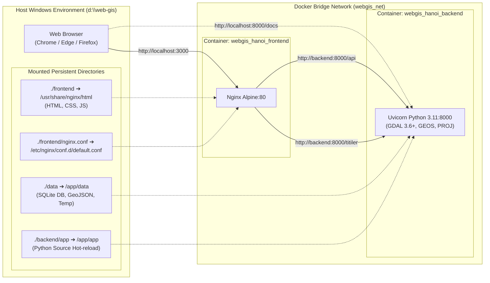
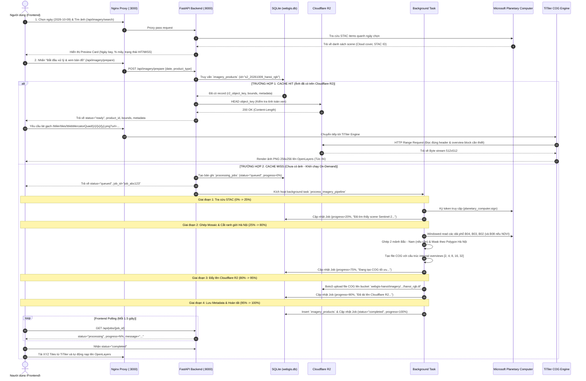

# KIẾN TRÚC HỆ THỐNG WEBGIS ẢNH VỆ TINH HÀ NỘI (PHIÊN BẢN 2.0)
### Microsoft Planetary Computer (MPC) + Cloudflare R2 + TiTiler + FastAPI + OpenLayers 10

---

## 1. TỔNG QUAN HỆ THỐNG V2

Hệ thống **Hanoi Satellite WebGIS v2** được thiết kế theo mô hình **On-Demand Processing & Intelligent Tiered Cache** (Xử lý theo nhu cầu & Bộ nhớ đệm phân tầng). Hệ thống giải quyết bài toán cốt lõi của viễn thám hiện đại: **Không lưu trữ tràn lan hàng Terabyte ảnh vệ tinh gốc**, mà xử lý tức thời đúng vùng quan tâm (AOI Hà Nội), tối ưu hóa dung lượng thành chuẩn **Cloud-Optimized GeoTIFF (COG)**, lưu trữ vĩnh viễn trên **Cloudflare R2** và phục vụ dynamic tile độ trễ cực thấp qua **TiTiler**.

### 🌟 Các cải tiến & điểm mới nổi bật trong Phiên bản 2.0:
1. **Kiến trúc Docker 2 tầng chuẩn hóa**: Tách biệt rõ ràng Reverse Proxy Nginx (cổng `3000`) và API/TiTiler Engine FastAPI (cổng `8000`), cấu hình Header chống Cache tĩnh và hỗ trợ Hot-reload toàn diện.
2. **Cơ chế Mosaic đa mảnh Bắc - Nam Hà Nội**: Tự động phát hiện và ghép 2 scene Sentinel-2 kế cận để bảo đảm trọn vẹn 100% ranh giới Hà Nội (không bị mất các huyện phía Nam như Mỹ Đức, Ứng Hòa, Phú Xuyên).
3. **Smart Date Picker & STAC Flyover Sync**: Khắc phục triệt để lỗi mất focus của Chromium datalist ("Other..."). Tách biệt ô chọn ngày chuẩn Calendar Picker (hỗ trợ Dark Mode `showPicker()`) và menu dropdown chọn nhanh ngày bay có sẵn từ Microsoft Planetary Computer kèm % mây và trạng thái R2.
4. **Hệ thống phục hồi tác vụ mồ côi (Orphan Job Recovery)**: Tự động rà soát và đánh dấu dọn dẹp các tiến trình bị gián đoạn khi máy chủ khởi động lại.
5. **Streaming Windowed Reads & COG Overviews**: Đọc trực tiếp các dải phổ từ xa không cần tải toàn bộ file 800MB của ESA, cắt mặt nạ theo GeoJSON ranh giới hành chính Hà Nội và nén Deflate/WebP giúp giảm 80% dung lượng.

---

## 2. SƠ ĐỒ KIẾN TRÚC TỔNG THỂ (OVERALL SYSTEM ARCHITECTURE V2)

```mermaid
flowchart TB
    %% ==========================================
    %% CLIENT LAYER
    %% ==========================================
    subgraph CLIENT["1. CLIENT TIER (Trình duyệt Web người dùng)"]
        direction TB
        subgraph UI_COMPONENTS["Giao diện WebGIS Glassmorphism"]
            MapOL["Bản đồ OpenLayers 10.4<br/>(XYZ Dynamic Layer + Vector Boundary)"]
            LeftPanel["Panel Trái: Kho ảnh R2<br/>(Catalog Gallery, Timeline, Cache Badges)"]
            RightPanel["Panel Phải: Thanh điều khiển<br/>(Band Controls, Opacity, Inspector)"]
            SmartPicker["Smart Date Picker & STAC Flyover<br/>(Lịch chuẩn Dark + Gợi ý ngày bay ít mây)"]
            ProgressModal["Realtime Progress Tracker<br/>(Polling 4 giai đoạn + Toast alerts)"]
        end
    end

    %% ==========================================
    %% PROXY & WEBSERVER LAYER
    %% ==========================================
    subgraph PROXY["2. REVERSE PROXY & GATEWAY (Docker: webgis_hanoi_frontend:3000)"]
        Nginx["Nginx Alpine Engine<br/>• Phục vụ Static HTML/CSS/JS (no-cache)<br/>• Reverse Proxy /api/ ➔ Backend:8000<br/>• Reverse Proxy /titiler/ ➔ Backend:8000"]
    end

    %% ==========================================
    %% BACKEND LAYER
    %% ==========================================
    subgraph BACKEND["3. APPLICATION TIER (Docker: webgis_hanoi_backend:8000)"]
        direction TB
        FastAPICore["FastAPI Application Core (main.py)<br/>• CORS Middleware • Startup Hook • Healthcheck"]
        
        subgraph API_ROUTERS["REST API Routers"]
            ImageryAPI["/api/imagery/*<br/>(catalog, dates, search, prepare, download)"]
            JobsAPI["/api/jobs/*<br/>(job status, progress polling)"]
        end

        subgraph ENGINES["Processing & Tile Engines"]
            TiTilerEngine["TiTiler Core Engine (/titiler/*)<br/>• WebMercatorQuad XYZ Tiles<br/>• HTTP Range Request Parser"]
            AsyncWorker["Background Worker Pipeline<br/>• STAC Resolver • Raster Processor<br/>• COG Builder • Boto3 S3 Uploader"]
        end

        subgraph SERVICES["Service Layer (Clean Architecture)"]
            STACService["stac_service.py<br/>(MPC Client, Token Signer, Tile Matcher)"]
            RasterService["raster_service.py<br/>(Windowed Read, Mosaic, Hanoi Clip, COG)"]
            StorageService["storage_service.py<br/>(Cloudflare R2, Boto3, Presigned URLs)"]
        end

        subgraph STORAGE_LOCAL["Local Persistence (Mounted Volume: ./data)"]
            SQLiteDB[(SQLite Database<br/>webgis.db + WAL)]
            TempStorage["Temp Raster Storage<br/>(data/temp/*.tif)"]
            BoundaryFile["Boundary GeoJSON<br/>(data/boundaries/hanoi.geojson)"]
        end
    end

    %% ==========================================
    %% EXTERNAL CLOUD LAYER
    %% ==========================================
    subgraph CLOUD["4. CLOUD INFRASTRUCTURE & DATA SOURCES"]
        MPC["Microsoft Planetary Computer<br/>• STAC API Catalog<br/>• Sentinel-2 L2A Asset Blobs (B04, B03, B02, B08)"]
        R2["Cloudflare R2 Object Storage<br/>• S3-Compatible Storage (Zero Egress Fee)<br/>• Bucket: webgis-hanoi (COG Data Lake)"]
    end

    %% ==========================================
    %% CONNECTIONS
    %% ==========================================
    CLIENT <-->|HTTP / Port 3000| Nginx
    Nginx -->|Proxy Pass /api/| ImageryAPI
    Nginx -->|Proxy Pass /api/| JobsAPI
    Nginx -->|Proxy Pass /titiler/| TiTilerEngine

    ImageryAPI --> STACService
    ImageryAPI --> StorageService
    ImageryAPI --> SQLiteDB
    JobsAPI --> SQLiteDB

    ImageryAPI -->|Kích hoạt tác vụ nền| AsyncWorker
    AsyncWorker --> STACService
    AsyncWorker --> RasterService
    AsyncWorker --> StorageService
    AsyncWorker --> SQLiteDB

    STACService <-->|Search & Token Sign| MPC
    RasterService <-->|Streaming Windowed Read| MPC
    RasterService -->|Clip Polygon| BoundaryFile
    RasterService -->|Lưu tạm COG| TempStorage
    StorageService <-->|Upload & Check Cache| R2

    TiTilerEngine <-->|HTTP Range Requests (Bytes)| R2
    MapOL <-->|Load XYZ Tiles| Nginx
```

---

## 3. SƠ ĐỒ ĐIỀU PHỐI DOCKER & HẠ TẦNG MẠNG (DEPLOYMENT TOPOLOGY)



---

## 4. LUỒNG DỮ LIỆU & MÁY TRẠNG THÁI CACHE (DATA FLOW & STATE MACHINE)

Toàn bộ quy trình tải và hiển thị ảnh vệ tinh diễn ra theo 2 nhánh: **Cache HIT (Nhanh, < 0.5s)** hoặc **Cache MISS (Xử lý On-Demand, ~15-30s)**.



---

## 5. THIẾT KẾ CÁC MODULE CHI TIẾT

### 5.1. Module Xử lý Raster Viễn thám (`app/services/raster_service.py`)
- **Ghép Mosaic 2 mảnh vệ tinh**: Sentinel-2 có kích thước mỗi granule khoảng 100x100km. Do hình dạng kéo dài theo chiều Bắc - Nam của Hà Nội, thành phố thường nằm giữa 2 tile (ví dụ: `48QWJ` và `48PWJ`). Thuật toán v2 tự động tải streaming cả 2 tile và ghép lại trước khi cắt theo ranh giới.
- **Cắt ranh giới hành chính Hà Nội (GeoJSON Masking)**: Sử dụng hàm `rasterio.mask.mask` với `crop=True`, loại bỏ toàn bộ dữ liệu thừa bên ngoài phạm vi thủ đô Hà Nội.
- **Tạo chuẩn Cloud-Optimized GeoTIFF (COG)**:
  - Cấu trúc Block: `tiled=True`, `blockxsize=512`, `blockysize=512`.
  - Nén: `compress=deflate` hoặc `zstd`, `predictor=2`.
  - Overviews Pyramid: Xây dựng các mức kim tự tháp ảnh nội tại (Decimations: 2, 4, 8, 16, 32) bằng thuật toán `average`.
  - Giúp TiTiler chỉ cần đọc đúng vài chục Kilobytes qua HTTP Range Requests thay vì đọc toàn bộ file.

### 5.2. Module Phục vụ Raster Tiles Động (`app/services/tiler_service.py`)
- Nhúng trực tiếp thư viện `titiler.core` vào FastAPI thông qua `TilerFactory`:
  ```python
  from titiler.core.factory import TilerFactory
  tiler_factory = TilerFactory()
  tiler_router = tiler_factory.router
  ```
- Định dạng Tile chuẩn: XYZ Web Mercator Quad (`/titiler/tiles/WebMercatorQuad/{z}/{x}/{y}.png`).
- Kết nối Cloudflare R2 thông qua đường dẫn công khai hoặc Presigned URL được ký bảo mật từ Backend, loại trừ hoàn toàn rủi ro SSRF.

### 5.3. Module Tương tác Người dùng & Smart Date Picker (Frontend v2)
- **Smart Date Picker**:
  - Tách hoàn toàn `<input type="date">` khỏi `<datalist>` để khắc phục dứt điểm lỗi trình duyệt Chromium hiển thị nút "Other..." không mở được lịch.
  - Hỗ trợ gọi phương thức hiện đại `input.showPicker()` khi người dùng nhấp vào bất kỳ điểm nào trên ô ngày hoặc biểu tượng lịch 📅.
  - Tích hợp `color-scheme: dark;` mang lại giao diện lịch hệ thống tối màu, sang trọng.
- **Flyover Date Recommendation Dropdown (`dl-quick-date-select`)**:
  - Tự động gọi API `/api/imagery/dates` theo tháng/năm đang xem.
  - Liệt kê toàn bộ các ngày vệ tinh bay qua, gắn nhãn rõ ràng: `2026-10-09 (Mây 7.75% · 💾 Đã lưu R2)`.
  - Đồng bộ hai chiều: Người dùng chọn ngày từ dropdown thì ô lịch tự đổi, và khi đổi ngày trên ô lịch thì danh sách gợi ý tự làm mới.

---

## 6. THIẾT KẾ CƠ SỞ DỮ LIỆU & LƯU TRỮ TRÊN CLOUDFLARE R2

### 6.1. Lược đồ Cơ sở dữ liệu SQLite (`data/webgis.db`)

#### Bảng `imagery_products` (Lưu thông tin các ảnh đã xử lý sẵn trên R2)
| Trường | Kiểu dữ liệu | Ràng buộc | Mô tả |
| :--- | :--- | :--- | :--- |
| `id` | VARCHAR | PRIMARY KEY | Khóa định danh sản phẩm (VD: `s2_20261009_hanoi_rgb`) |
| `acquisition_date` | VARCHAR | INDEX | Ngày chụp ảnh vệ tinh (`YYYY-MM-DD`) |
| `collection` | VARCHAR | NOT NULL | Bộ sưu tập STAC (mặc định: `sentinel-2-l2a`) |
| `product_type` | VARCHAR | INDEX | Loại sản phẩm (`rgb`, `ndvi`) |
| `cloud_cover` | FLOAT | NOT NULL | Tỷ lệ che phủ mây (%) |
| `source_scenes` | JSON | NOT NULL | Danh sách STAC Item IDs được dùng để ghép |
| `r2_object_key` | VARCHAR | INDEX | Đường dẫn lưu trên Cloudflare R2 |
| `bounds` | JSON | NOT NULL | Tọa độ bao `[min_lon, min_lat, max_lon, max_lat]` |
| `file_size_bytes` | BIGINT | NULLABLE | Dung lượng file GeoTIFF |
| `created_at` | TIMESTAMP | UTC NOW | Thời điểm tạo sản phẩm |

#### Bảng `processing_jobs` (Theo dõi tiến độ tác vụ On-Demand)
| Trường | Kiểu dữ liệu | Ràng buộc | Mô tả |
| :--- | :--- | :--- | :--- |
| `job_id` | VARCHAR | PRIMARY KEY | Mã UUID duy nhất của tiến trình |
| `product_id` | VARCHAR | INDEX | Mã sản phẩm mục tiêu |
| `acquisition_date` | VARCHAR | INDEX | Ngày ảnh cần xử lý |
| `product_type` | VARCHAR | NOT NULL | Phân loại ảnh (`rgb` / `ndvi`) |
| `status` | VARCHAR | INDEX | Trạng thái (`queued`, `processing`, `completed`, `failed`) |
| `progress` | INTEGER | DEFAULT 0 | Tiến độ xử lý (0 đến 100%) |
| `message` | VARCHAR | NOT NULL | Thông điệp hiển thị cho người dùng |
| `error` | TEXT | NULLABLE | Nội dung chi tiết lỗi nếu thất bại |
| `created_at` | TIMESTAMP | UTC NOW | Thời điểm khởi tạo |
| `updated_at` | TIMESTAMP | UTC NOW | Thời điểm cập nhật tiến độ gần nhất |

---

### 6.2. Cấu trúc Bucket Cloudflare R2 (`webgis-hanoi`)

```text
webgis-hanoi/
├── boundaries/
│   └── hanoi.geojson                        # File ranh giới chuẩn hành chính Thủ đô
│
├── imagery/
│   └── sentinel-2-l2a/
│       └── 2026/
│           └── 10/
│               ├── 09/
│               │   ├── hanoi_rgb_20261009.tif   # COG True Color (Đã cắt & tối ưu overviews)
│               │   └── hanoi_ndvi_20261009.tif  # COG Chỉ số thực vật (Phát triển mở rộng)
│               ├── 06/
│               │   └── hanoi_rgb_20261006.tif
│               └── 04/
│                   └── hanoi_rgb_20261004.tif
│
└── thumbnails/
    └── 2026-10-09_thumb.webp                # Ảnh preview nhanh phục vụ Gallery
```

---

## 7. BẢO MẬT & CHIẾN LƯỢC TỐI ƯU HỆ THỐNG V2

1. **Phòng chống SSRF (Server-Side Request Forgery)**:
   - Toàn bộ tham số URL truyền vào TiTiler chỉ được phép trỏ tới domain bucket Cloudflare R2 đã cấu hình trong biến môi trường hoặc các signed assets của Microsoft Planetary Computer.
2. **Cơ chế Orphan Job Recovery (Khởi động an toàn)**:
   - Khi khởi động lại máy chủ (container restart), hàm `on_startup` trong `main.py` tự động quét database và chuyển toàn bộ các job còn treo ở trạng thái `queued` hoặc `processing` sang `failed`, tránh việc frontend bị treo polling vĩnh viễn.
3. **Chống trùng lặp tác vụ (Concurrency Control)**:
   - Trước khi tạo Job mới, hệ thống kiểm tra xem có Job nào đang chạy cùng `acquisition_date` và `product_type` hay không. Nếu có, trả về ngay `job_id` hiện tại để frontend cùng lắng nghe mà không tạo tác vụ tải trùng lặp.
4. **Không phát sinh chi phí truyền tải (Zero Egress Cost)**:
   - Sử dụng Cloudflare R2 hoàn toàn miễn phí băng thông chiều tải ra (Zero Egress Fee), cho phép phục vụ hàng triệu lượt request tile vệ tinh cho người dùng mà không lo đội chi phí đám mây.
