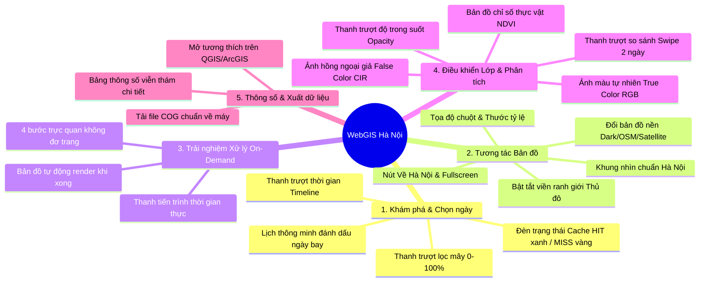
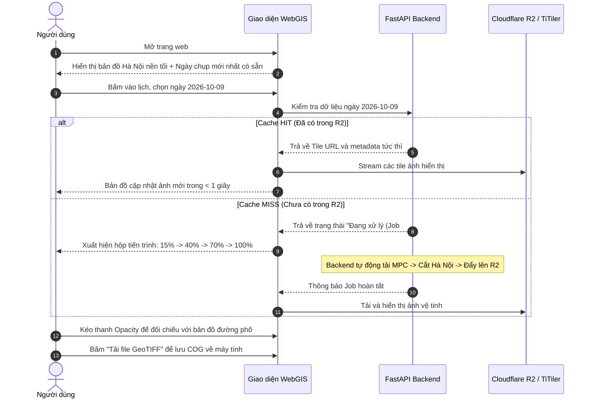

# ĐẶC TẢ YÊU CẦU NGƯỜI DÙNG & TÍNH NĂNG CHỨC NĂNG
## (USER REQUIREMENTS & FUNCTIONAL SPECIFICATIONS)
### Dự án: WebGIS Ảnh Vệ Tinh Hà Nội (MPC + Cloudflare R2 + TiTiler + OpenLayers)

---

## 1. ĐỐI TƯỢNG SỬ DỤNG (USER PERSONAS)

1. **Sinh viên / Giảng viên ngành GIS & Viễn thám**: Cần công cụ trực quan để tra cứu ảnh Sentinel-2 nhanh chóng, kiểm tra chất lượng mây, trích xuất dữ liệu GeoTIFF đã chuẩn hóa để đưa vào QGIS/ArcGIS thực hành.
2. **Chuyên viên Quy hoạch & Môi trường**: Cần theo dõi sự thay đổi lớp phủ đô thị, mật độ cây xanh (NDVI), biến động mặt nước sông Hồng, hồ Tây qua các năm.
3. **Người dùng phổ thông**: Muốn ngắm nhìn Thủ đô Hà Nội từ vũ trụ vào bất kỳ ngày nào trong quá khứ với giao diện mượt mà, hiện đại, không cần kiến thức kỹ thuật phức tạp.

---

## 2. NĂM NHÓM CHỨC NĂNG CỐT LÕI (CORE FEATURE MODULES)



---

### PHÂN HỆ 1: Khám phá & Chọn ảnh vệ tinh theo thời gian (Timeline & Satellite Pass Discovery)

* **1.1. Lịch trực quan (Smart Satellite Calendar)**:
  - Khi mở lịch, các ngày vệ tinh Sentinel-2 bay qua chụp Hà Nội (chu kỳ khoảng 5 ngày/lần) sẽ được đánh dấu sáng trực quan.
  - Phân loại trạng thái dữ liệu bằng màu sắc rõ ràng:
    - 🟢 **Xanh lá (Cache HIT - Đã lưu trong kho R2)**: Ảnh đã được cắt sẵn, bấm vào là xem được ngay tức thì (< 1 giây).
    - 🟡 **Vàng (Cache MISS - Có trên Microsoft Planetary Computer)**: Ảnh có sẵn trên đám mây của Microsoft, bấm vào hệ thống sẽ kích hoạt tải cắt theo nhu cầu.
* **1.2. Bộ lọc tỷ lệ mây (Cloud Coverage Slider)**:
  - Thanh trượt từ `0%` đến `100%` (mặc định `< 20%`).
  - Tự động lọc bớt những ngày Hà Nội bị mây mù che phủ dày đặc, chỉ giữ lại những ngày trời trong xanh chất lượng cao.
* **1.3. Thanh trượt thời gian (Timeline Slider)**:
  - Thanh trượt ngang ở chân màn hình cho phép người dùng kéo qua lại giữa các tháng/năm một cách trực quan để xem tiến trình phát triển của Hà Nội theo thời gian.

---

### PHÂN HỆ 2: Tương tác bản đồ chuyên nghiệp (Interactive GIS Mapping)

* **2.1. Khung nhìn chuẩn Hà Nội (Default Spatial View)**:
  - Khi vừa mở trang, bản đồ tự động căn giữa toàn bộ phạm vi Hà Nội `[105.8342°E, 21.0278°N]`, mức zoom 10 bao quát từ Ba Vì, Sóc Sơn đến nội đô Hoàn Kiếm, Gia Lâm.
* **2.2. Bộ công cụ điều hướng tiện ích**:
  - Nút **"Về Hà Nội" (Reset Extent)**: Nhanh chóng đưa khung nhìn quay về toàn cảnh Thủ đô nếu người dùng vô tình kéo bản đồ đi quá xa.
  - Nút **Toàn màn hình (Fullscreen)**: Mở rộng tối đa không gian làm việc.
  - **Tọa độ con trỏ thời gian thực**: Hiển thị kinh độ/vĩ độ (WGS84) chính xác theo vị trí trỏ chuột.
  - **Thước tỷ lệ bản đồ (Scale line)**: Tự động co giãn theo mức zoom thực tế.
* **2.3. Chuyển đổi bản đồ nền (Basemap Switcher)**:
  - **CartoDB Dark Matter**: Nền tối tối giản, làm nổi bật tuyệt đối màu sắc ảnh vệ tinh.
  - **OpenStreetMap (OSM)**: Nền đường phố chi tiết, hiển thị tên đường, cầu, địa danh.
  - **Esri / Google Satellite Hybrid**: Đối chiếu ảnh Sentinel-2 với ảnh vệ tinh thương mại độ phân giải cao.
* **2.4. Lớp ranh giới Hà Nội (Administrative Boundary Layer)**:
  - Nút công tắc bật/tắt đường viền ranh giới hành chính Hà Nội với hiệu ứng viền neon phát sáng dễ nhận biết.

---

### PHÂN HỆ 3: Trải nghiệm xử lý On-Demand mượt mà (Real-Time Feedback)

Khi người dùng chọn một ngày **chưa có sẵn trong R2 (Cache MISS)**:
* **Hộp thông báo tiến trình thời gian thực (Progress Toast / Modal)**:
  - Hệ thống hiển thị thanh tiến trình và thông điệp động:
    - ⏳ *Bước 1 (15%): Đang tra cứu cảnh ảnh trên Microsoft Planetary Computer...*
    - 📥 *Bước 2 (40%): Đang stream các dải phổ 10m qua đường truyền ảo...*
    - ✂️ *Bước 3 (70%): Đang cắt theo ranh giới Hà Nội & Tối ưu chuẩn COG...*
    - ☁️ *Bước 4 (90%): Đang đồng bộ dữ liệu vào Cloudflare R2 Data Lake...*
    - ✅ *Bước 5 (100%): Hoàn tất! Ảnh đang hiển thị lên bản đồ.*
* **Trải nghiệm Non-blocking (Không gián đoạn)**:
  - Người dùng vẫn có thể thoải mái zoom/pan bản đồ trong lúc hệ thống đang xử lý ngầm, không gặp tình trạng đơ trang hay timeout.
  - Khi hoàn thành, lớp ảnh vệ tinh tự động xuất hiện trên màn hình mà không cần reload trang.

---

### PHÂN HỆ 4: Điều khiển lớp & Phân tích viễn thám (Layer Controls & Analytics)

* **4.1. Thanh trượt độ trong suốt (Opacity Slider 0% – 100%)**:
  - Cho phép làm mờ dần ảnh vệ tinh để nhìn xuyên xuống bản đồ đường phố bên dưới. Rất hữu ích khi cần xác định một khu đô thị mới hoặc công trình ven sông nằm ở vị trí nào ngoài đời thực.
* **4.2. Chuyển đổi chế độ màu / Sản phẩm viễn thám**:
  - 🌈 **True Color (RGB)**: Màu sắc tự nhiên (Đỏ - Xanh lá - Xanh dương) như nhìn bằng mắt thường từ vũ trụ.
  - 🌿 **NDVI (Chỉ số thực vật)**: Bản đồ nhiệt màu thể hiện mật độ cây xanh đô thị Hà Nội (Màu xanh đậm = Rừng Ba Vì, công viên; Màu vàng/đỏ = Khu dân cư bê tông, đất trống).
  - 🔴 **False Color (Hồng ngoại giả - CIR)**: Kết hợp dải hồng ngoại gần để phân biệt rõ ranh giới mặt nước sông Hồng, hồ Tây và các vùng ngập úng.
* **4.3. Thanh so sánh Trước / Sau (Swipe / Split-screen Slider)**:
  - Chia đôi màn hình bằng thanh trượt dọc: Nửa bên trái là ảnh ngày A, nửa bên phải là ảnh ngày B. Kéo thanh trượt để so sánh biến động đô thị hoặc biến thiên theo mùa.

---

### PHÂN HỆ 5: Thông số kỹ thuật & Xuất dữ liệu (Metadata & Data Export)

* **5.1. Bảng thông số viễn thám chi tiết (Metadata Card)**:
  - Ngày giờ thu nhận ảnh (UTC & Giờ Việt Nam GMT+7).
  - Vệ tinh chụp: *Sentinel-2A* hoặc *Sentinel-2B*.
  - Độ phân giải không gian: *10 mét/pixel*.
  - Tỷ lệ mây che phủ của cảnh: *VD: 4.8%*.
  - Dung lượng file COG trên Cloudflare R2.
  - Trạng thái: *Đã lưu trong Cache (HIT)*.
* **5.2. Tải xuống dữ liệu chuẩn GeoTIFF (Download COG)**:
  - Cung cấp nút bấm **"Tải GeoTIFF (COG)"** cho phép người dùng tải trực tiếp file ảnh đã cắt theo ranh giới Hà Nội về máy tính.
  - File tải về có tọa độ chuẩn EPSG:4326/EPSG:3857, sẵn sàng mở ngay trên **QGIS, ArcGIS** hoặc dùng để phân loại lớp phủ bằng mô hình AI/Machine Learning.

---

## 3. SƠ ĐỒ BỐ CỤC GIAO DIỆN (UI WIREFRAME & LAYOUT)

```text
┌────────────────────────────────────────────────────────────────────────────────────────┐
│ 🛰️ HANOI SATELLITE WEBGIS                    [📅 Chọn ngày: 2026-10-09 ▾]  [☁️ Mây < 20% ▾] │
├────────────────────────────────┬───────────────────────────────────────────────────────┤
│ ⚙️ BẢNG ĐIỀU KHIỂN (Sidebar)   │ 🗺️ BẢN ĐỒ CHÍNH (OpenLayers Canvas)                   │
│                                │                                                       │
│ 🎯 CHẾ ĐỘ HIỂN THỊ:            │                       /\  (Sóc Sơn)                   │
│  (o) Màu tự nhiên (True Color) │                      /  \                             │
│  ( ) Chỉ số thực vật (NDVI)    │                (Ba Vì)   [Hồ Tây]                     │
│  ( ) Hồng ngoại giả (CIR)      │                    \       ~~~~ [Sông Hồng]           │
│                                │                     \_____/                           │
│ 🔍 ĐIỀU CHỈNH:                 │                                                       │
│  Độ mờ (Opacity): [━━━●━━] 80% │  [+] [ - ]                                            │
│  Lớp ranh giới:   [ BẬT ]      │  [⟲ Về Hà Nội]                     [⛶ Toàn màn hình] │
│  Bản đồ nền:      [Dark / OSM] │                                                       │
│                                ├───────────────────────────────────────────────────────┤
│ 📊 THÔNG SỐ CẢNH ẢNH:          │ ⏳ TRẠNG THÁI HỆ THỐNG:                               │
│  • Ngày chụp: 09/10/2026       │  [Cache HIT] File R2 sẵn sàng (Phản hồi: 0.35s)       │
│  • Độ mây: 6.2%                │                                                       │
│  • Độ phân giải: 10m           ├───────────────────────────────────────────────────────┤
│  • Dung lượng: 22.4 MB         │ 📍 105.8342°E, 21.0278°N  |  Tỷ lệ: 1:50,000          │
│                                │                                                       │
│ 💾 [ ⬇️ Tải file GeoTIFF ]     │ ◀━━[2026-08]━━━━━●━━━━━[2026-09]━━━━━[2026-10]━━▶    │
│                                │                  (Thanh trượt thời gian Timeline)     │
└────────────────────────────────┴───────────────────────────────────────────────────────┘
```

---

## 4. KỊCH BẢN TRẢI NGHIỆM NGƯỜI DÙNG MẪU (USER JOURNEY)


